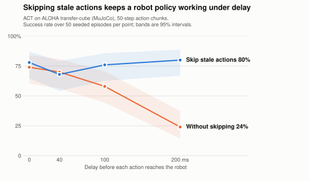

# Shakedown

Regression testing for learned robot policies.

Shakedown runs a policy checkpoint through a suite of seeded scenarios in
simulation (dimmed lights, a knocked camera, clutter, sensor noise, latency)
and reports, per condition, whether it passes, with a 95% interval, a paired
statistical comparison against a baseline checkpoint, and a replay of every
failure. It tests the runtime settings a checkpoint ships with, not only its
weights.

## Result: one runtime setting decides whether a policy survives delay



When each action reaches the robot 200 ms late, the public ACT policy for
ALOHA transfer-cube (`lerobot/act_aloha_sim_transfer_cube_human`, 50-step
action chunks) succeeds in 12 of 50 seeded episodes (24%, 95% interval
14–37%). Dropping the actions in each new chunk that are already stale when
they arrive (`latency_compensation=auto`) brings it to 40 of 50 (80%,
67–89%). The weights are the same; only a runtime setting changes. With no
delay, every configuration scores 70–78%.

Success over 50 seeded episodes per cell (seed 1000; one control step is 20 ms):

| Delay | 50-step chunks | + skip stale | 25-step chunks | + skip stale | 100-step chunks | + skip stale |
|---|---|---|---|---|---|---|
| 0 ms | 37/50 (74%) | 39/50 (78%) | 38/50 (76%) | 35/50 (70%) | 35/50 (70%) | 35/50 (70%) |
| 40 ms | 35/50 (70%) | 34/50 (68%) | 27/50 (54%) | 36/50 (72%) | 34/50 (68%) | 36/50 (72%) |
| 100 ms | 29/50 (58%) | 38/50 (76%) | 3/50 (6%) | 26/50 (52%) | 34/50 (68%) | 36/50 (72%) |
| 200 ms | 12/50 (24%) | 40/50 (80%) | 0/50 (0%) | 19/50 (38%) | 24/50 (48%) | 36/50 (72%) |

Shorter chunks replan more often, so without compensation they suffer most
from delay.

With no delay, skipping stale actions skips nothing, so each pair of cells in
the 0 ms row is the same configuration run twice. The pairs still differ by up
to 6 points (4 of 50 seeds changed outcome with 50-step chunks, 7 of 50 with
25-step chunks). Runs on the cloud runner are not bit-reproducible across
machines, because each condition runs in its own container. Read that spread
as the noise floor for the rest of the table.

The runs were made on 28 September 2026 on Modal (Linux, CUDA) with the
`aloha-latency` suite. Per-cell counts and intervals are in
[`results/latency-skip-stale.json`](results/latency-skip-stale.json). It and
the chart are built by `scripts/build-latency-results.py` from the six runs in
[`results/runs/latency/`](results/runs/latency/), which hold every episode's
outcome (videos and traces are not included). To reproduce one column:

```sh
shakedown run scenarios/aloha-latency \
  --policy "lerobot:lerobot/act_aloha_sim_transfer_cube_human?n_action_steps=50&latency_compensation=auto" \
  --label n50-comp --episodes 50
```

### Limits of this result

- **One checkpoint, one task.** On ALOHA insertion
  (`lerobot/act_aloha_sim_insertion_human`, which succeeds in only 11 of 50
  episodes without delay), skipping stale actions clearly helped only at
  200 ms: 1/50 to 10/50 with 50-step chunks (paired p = 0.004). At 40 and
  100 ms, and with 100-step chunks, the differences are within noise.
- **Not every policy benefits.** With Diffusion Policy on PushT
  (`lerobot/diffusion_pusht`, 30 episodes per cell, run locally on an Apple
  M4 Max), 400 ms of delay cut success from 22/30 to 7/30, and skipping stale
  actions gave 9/30 (p = 0.75): no clear gain.
- **The delay is known exactly.** With `auto`, the runner tells the policy the
  simulated delay of each condition. That delay is fixed for the whole
  episode, with no jitter. On a real robot the delay has to be measured, and
  it varies.
- **Hardware.** The cloud runs used Modal workers with T4 GPUs, the GPU set in
  `cloud/modal_app.py`. The result files record the device only as `cuda`.

The runs behind the first two points are in
[`results/runs/replicate-insertion/`](results/runs/replicate-insertion/) and
[`results/runs/replicate-pusht/`](results/runs/replicate-pusht/).

### Prior work

Compensating for inference delay in action-chunking policies is already
known. Real-time chunking (Kevin Black, Manuel Y. Galliker and Sergey Levine,
[Real-Time Execution of Action Chunking Flow Policies](https://arxiv.org/abs/2506.07339),
NeurIPS 2025) starts from the same observation: when a chunk is planned with
d steps of delay, its first d actions arrive too late to be used. It goes
further, generating the next chunk while the current one executes and
treating that as inpainting, so that consecutive chunks join smoothly. Action
chunking and temporal ensembling, which the demo suite also compares, come
from ACT (Tony Z. Zhao, Vikash Kumar, Sergey Levine and Chelsea Finn,
[Learning Fine-Grained Bimanual Manipulation with Low-Cost Hardware](https://arxiv.org/abs/2304.13705),
RSS 2023). This result reproduces the direction on a public checkpoint. The
point of Shakedown is to catch a setting like this before deployment, not to
claim the fix is new.

## What is in this repository

| Path | What it is |
|---|---|
| `engine/` | The Python engine, the `shakedown` command line tool and the field SDK |
| `scenarios/` | Scenario suites: `aloha-transfer-cube` (19 conditions), `aloha-latency` (6), `aloha-insertion-latency` (4), `pusht` (6), `pusht-latency` (4), `pusht-latency-short` (3) |
| `results/` | The delay result above: summary, chart, and the raw runs it is built from |
| `cloud/` | The cloud runner on Modal: one GPU container per condition |
| `apps/web/` | The dashboard, landing page and documentation (Next.js, Supabase) |
| `supabase/` | Database schema, row level security and storage, as migrations |
| `action/` | A GitHub Action that runs a suite and fails the job on a regression |
| `examples/` | An experiment file for a real SO-101 arm (`shakedown real run`) |
| `e2e/` | End-to-end tests that drive a real browser and the real CLI |
| `scripts/` | Seeding the demo project, building the landing page data and the delay result, and running suites on the cloud runner |

## Requirements

- Python 3.10 or newer. CI and the reported runs use 3.11; the unit tests
  also pass on 3.10.
- Node.js 20 or newer for the web app; 22 is recommended
- Docker and the [Supabase CLI](https://supabase.com/docs/guides/cli) for the local database
- Google Chrome, only for the end-to-end tests

The command line tool needs none of the web parts. It runs by itself.

## Quick start: the command line tool

```sh
python3.11 -m venv engine/.venv
engine/.venv/bin/pip install -e "engine[lerobot]"

engine/.venv/bin/shakedown list                                  # environments and perturbations
engine/.venv/bin/shakedown validate scenarios/aloha-transfer-cube
engine/.venv/bin/shakedown run scenarios/aloha-transfer-cube \
  --policy lerobot:lerobot/act_aloha_sim_transfer_cube_human \
  --label act --episodes 10 --workers 4
```

Results are written to `runs/<timestamp>-<label>/`: `result.json`, one trace
per episode, and videos of the failures. Run a second policy with
`--baseline runs/<first run>` to get a paired comparison.

## Quick start: the dashboard

```sh
make setup        # engine, web dependencies, local database
# copy the URL and keys printed by `supabase start` into apps/web/.env.local
make dev          # http://localhost:3400
```

`make setup` uses `python3.11`; pass `PYTHON=python3.10` (or another
interpreter) to use a different one.

Sign up, create a project, create an API key under Settings, then:

```sh
export SHAKEDOWN_URL=http://localhost:3400
export SHAKEDOWN_API_KEY=shk_...
engine/.venv/bin/shakedown run scenarios/aloha-transfer-cube \
  --policy lerobot:lerobot/act_aloha_sim_transfer_cube_human --label v1 --upload
```

The public demo project, and the matrix on the landing page, are built from
real runs:

```sh
make demo         # about 1.5 hours on an M4 Max: 4 policies x 19 conditions x 50 episodes
```

## Tests

```sh
make test                      # engine unit and simulator tests, web unit tests
npm install --prefix e2e       # once: the browser driver for the end-to-end tests
node e2e/flow.mjs              # browser and CLI, against the running app
```

## Deploying

The web app is a standard Next.js application and the database is a standard
Supabase project.

1. Create a Supabase project and run `supabase link` then `supabase db push`.
2. In the project's Auth settings, set the site URL to your domain and add
   `https://<domain>/auth/confirm` as a redirect URL. Email confirmation is
   off in the local configuration; decide whether you want it on.
3. Deploy `apps/web` with these environment variables:
   `NEXT_PUBLIC_SUPABASE_URL`, `NEXT_PUBLIC_SUPABASE_ANON_KEY`,
   `SUPABASE_SERVICE_ROLE_KEY` and `NEXT_PUBLIC_SITE_URL`. Optionally:
   `ANTHROPIC_API_KEY` (enables "Explain this failure"),
   `SHAKEDOWN_CLOUD_URL` and `SHAKEDOWN_CLOUD_TOKEN` (enable cloud runs; see
   `cloud/modal_app.py`), and `NEXT_PUBLIC_REPO_URL` (shows links to the
   source repository). `apps/web/.env.example` lists them all.
4. Run `node scripts/seed-demo.mjs` against it and upload the demo runs.

The service role key bypasses row level security. It must only ever be set
on the server.

## What has and has not been verified

Verified on this codebase, on macOS with an Apple M4 Max:

- The engine runs real pretrained policies (ACT in MuJoCo, Diffusion Policy
  on PushT). On one machine, ACT runs are deterministic: the same seeds give
  the same outcomes in serial and in parallel, and again on a full re-run.
  Across machines they are not; see the 0 ms row of the delay table.
- Every perturbation changes the scene or the model as intended (simulator tests).
- The served-policy protocol gives the same actions as the same policy in process.
- Sign-up, projects, API keys, live upload, replay from private storage,
  comparison, and isolation between accounts (end-to-end test).
- The engine runs on Linux with CUDA: the latency results above ran on Modal
  cloud workers.

Not yet verified. Treat these as written but untested in the real world:

- **No real robot has been used.** The sim-to-real workflow has only seen
  synthetic trial logs. Whether simulated results predict real ones for a
  given scene is exactly what that workflow exists to measure, and it has
  not been measured.
- **No real phone scan has been imported.** The scan importer is tested with
  generated meshes.
- **Policies other than ACT and Diffusion Policy** load through the same
  LeRobot code path but have not been run.
- **CI runners.** The GitHub Action and the EGL rendering path have not been
  run on a hosted GitHub runner.
- **"Explain this failure"** has not been run against the live API, because
  no API key was available when it was written.
- **Production deployment**, email delivery, and load.
- **No outside users.** Nobody outside the author has run it yet.

## License

To be decided. Until a license is chosen and a `LICENSE` file is added, the
code is not licensed for use by others.
